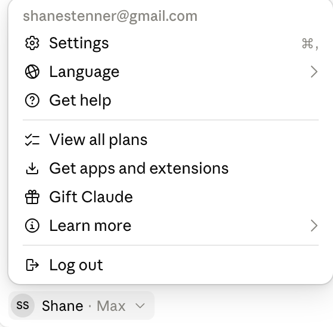
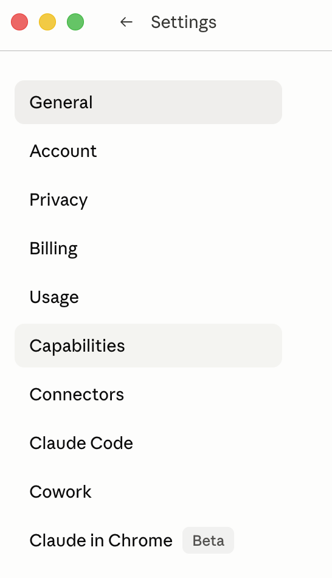
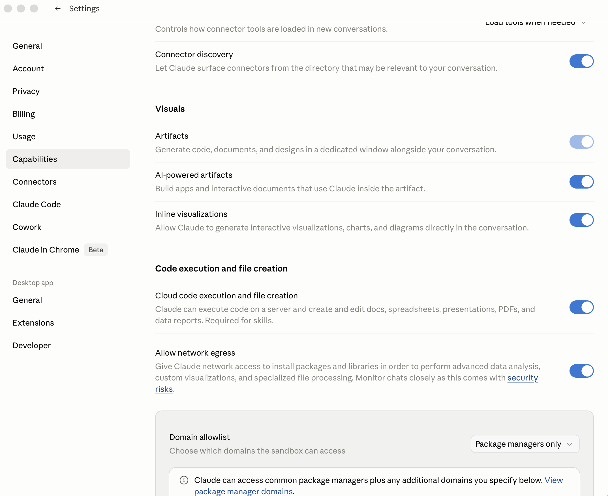
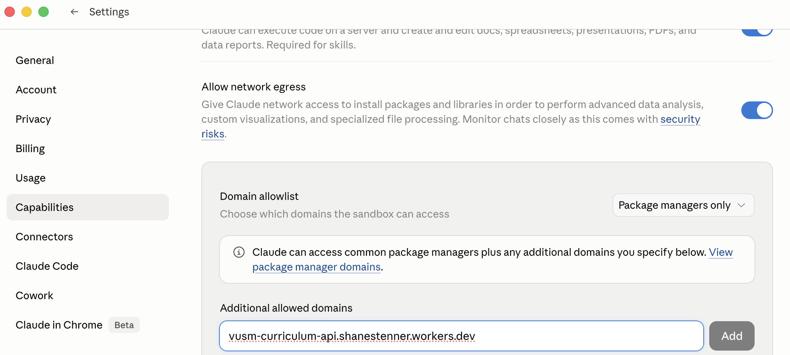
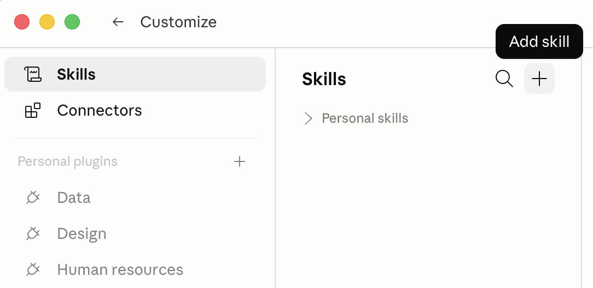
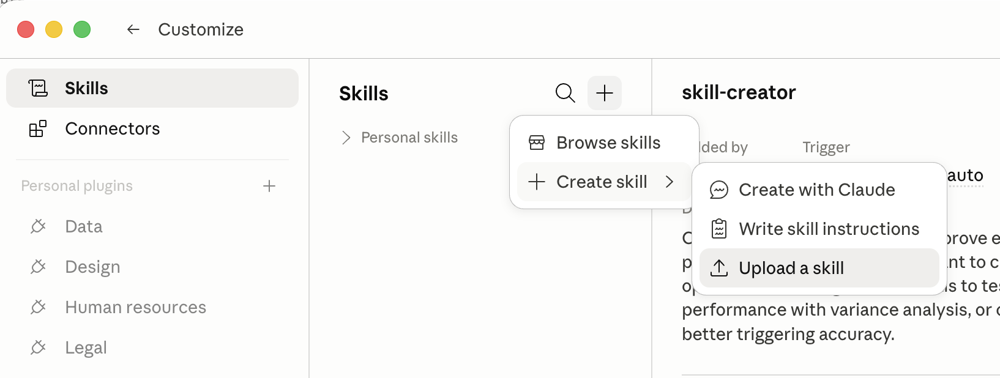
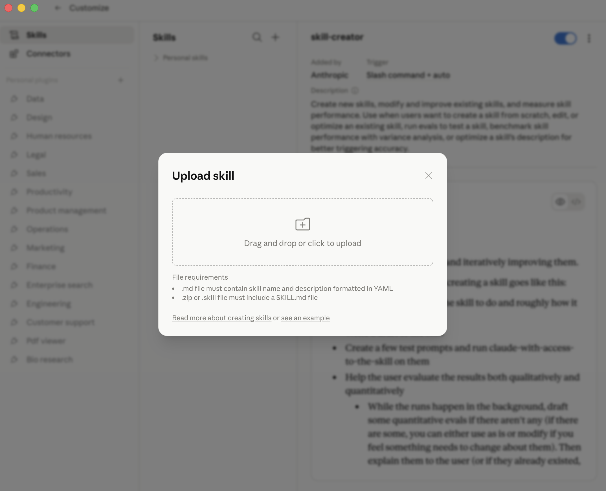
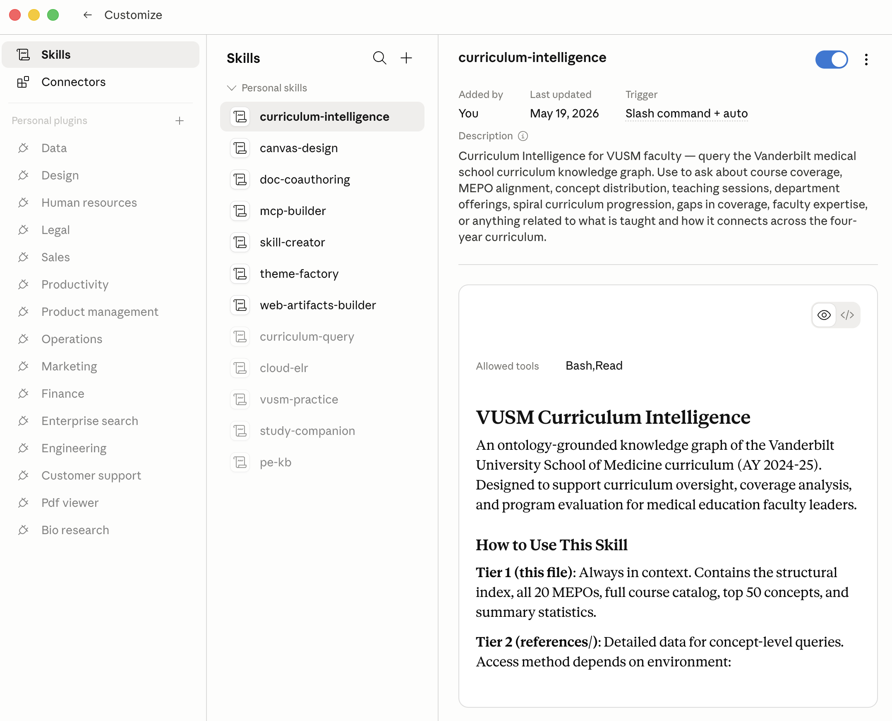

# Installing on claude.ai (web browser)

Click-by-click steps for installing the two **VUSM Student Skills** —
Student Coach and Student Tutor — in your web browser. The main
[README](README.md) has the short version; this is the detailed
walkthrough.

**Authoritative source:** Anthropic's [Use Skills in Claude](https://support.claude.com/en/articles/12512180-use-skills-in-claude#h_a4222fa77b)
article. If the UI labels below ever drift from what you see, follow
Anthropic's article — they update it as Claude evolves.

Tested on Chrome, Safari, Firefox, and Edge.

---

## Prerequisites: Capabilities settings (one-time)

Three things must be configured before the skills can talk to the
curriculum API. Once set, you don't revisit them.

### Step 1: Open Settings → Capabilities

1. Open **[claude.ai](https://claude.ai)** and sign in.
2. Click your profile (bottom-left) and choose **Settings**.

   

3. In the Settings sidebar, click **Capabilities**.

   

### Step 2: Enable code execution and network egress

In the Capabilities panel, make sure both are toggled on:

- **"Code execution and file creation"** — lets the skills run code in a sandbox.
- **"Allow network egress"** — lets that sandboxed code reach the internet.



### Step 3: Add the curriculum API to the Domain allowlist

Scroll to the **Domain allowlist** section. By default it's "Package
managers only" — the sandbox can reach npm / PyPI but NOT our curriculum
API. Add our hostname explicitly.

In the **"Additional allowed domains"** field, paste:

```
vusm-curriculum-api.shanestenner.workers.dev
```

Click **Add**.



Without this step, the skills install and appear in your Skills list —
but every query that reaches the curriculum data fails. (Switching the
dropdown to **"All domains"** also works; it's just broader.)

---

## Step 1: Open the Skills section

In the top navigation (or sidebar), click **Customize**, then **Skills**.



## Step 2: Add a skill

Click the **"+"** button at the top-right of the Skills list. A small
menu appears.



Click **"+ Create skill"**.

## Step 3: Upload the bundles — do this twice

In the dialog, click **"Upload a skill"** and pick a zip from where
Shane's email saved it (usually Downloads). **Repeat for both:**

- `student-coach-<your-name>.zip` — Claude previews **Name:**
  `student-coach`, description starting *"VUSM curriculum study planner…"*
- `student-tutor-<your-name>.zip` — **Name:** `student-tutor`,
  description starting *"Bastani-constrained tutor and assessor…"*

Confirm/save each.



## Step 4: Verify both appear

Both **Student Coach** and **Student Tutor** should show in your Skills
list, each with a toggle (default: on).



## Step 5: Try them

Open a new conversation (top-left "+ New chat"). You can let Claude pick
the skill from what you ask, or invoke one explicitly via the slash menu
— `/student-coach` or `/student-tutor`.

- Student Coach: *"What should I focus on before my renal block exam?"*
- Student Tutor: *"Quiz me on acid-base disorders at an application level."*

A successful Coach answer names specific VUSM sessions, objectives, and
how topics build across phases. A successful Tutor response makes *you*
reason first — it hints rather than handing over the answer.

If you get a generic medical answer with no VUSM specifics, the skill
probably didn't activate — go back to **Customize → Skills** and confirm
the toggle is on.

---

## Troubleshooting

**"Code execution must be enabled" or similar error.**
The Capabilities prerequisite ("Code execution and file creation") wasn't
completed. Go back to that section.

**The upload says "Skill not valid" or "Invalid skill structure."**
- Upload the **`.zip` file**, not the unzipped folder.
- The zips are named `student-coach-<your-name>.zip` and
  `student-tutor-<your-name>.zip`.
- Each is tiny — well under ~100 KB.

**A skill is listed but Claude doesn't seem to use it.**
- Be explicit about what you want — "quiz me", "make a study plan",
  "walk me through a case" — or invoke `/student-coach` / `/student-tutor`.
- Confirm the toggle is on in Customize → Skills.

**Claude says it can't reach the API / "request failed."**
Most common cause: **the API hostname isn't in your Domain allowlist.**
Settings → **Capabilities** → **Additional allowed domains** → confirm
`vusm-curriculum-api.shanestenner.workers.dev` is listed, and that
**"Allow network egress"** is on.

If both are set, it's likely transient — retry in 30 seconds. If it
persists past a minute, email Shane.

**I want to remove a skill.**
Customize → Skills → (the skill) → Remove. The bundle is deleted from
your account; you can re-upload the same zip later (the key stays valid
until the pilot ends or you ask Shane to revoke it).

If the UI doesn't match this guide, Anthropic's [official guide](https://support.claude.com/en/articles/12512180-use-skills-in-claude#h_a4222fa77b)
is the most current source.
