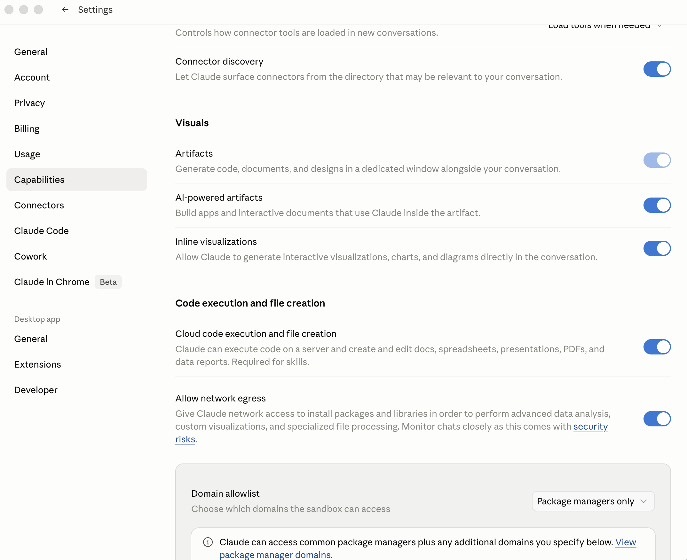
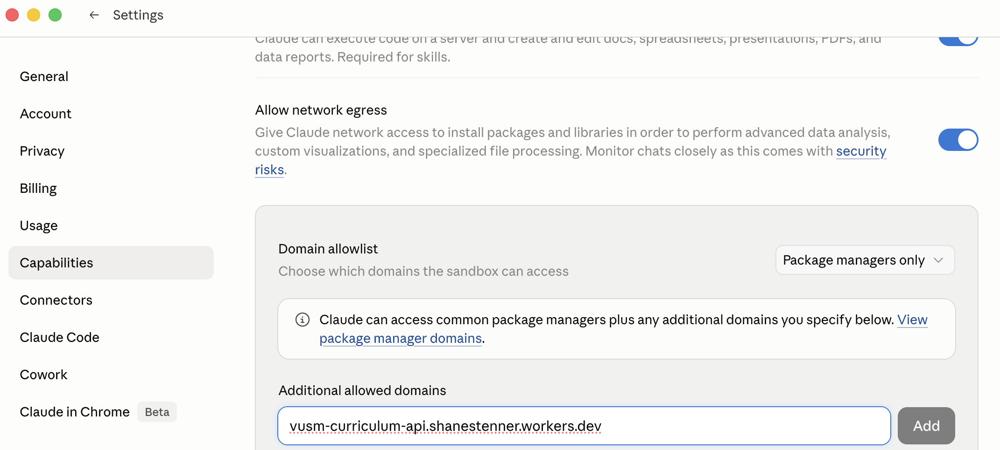
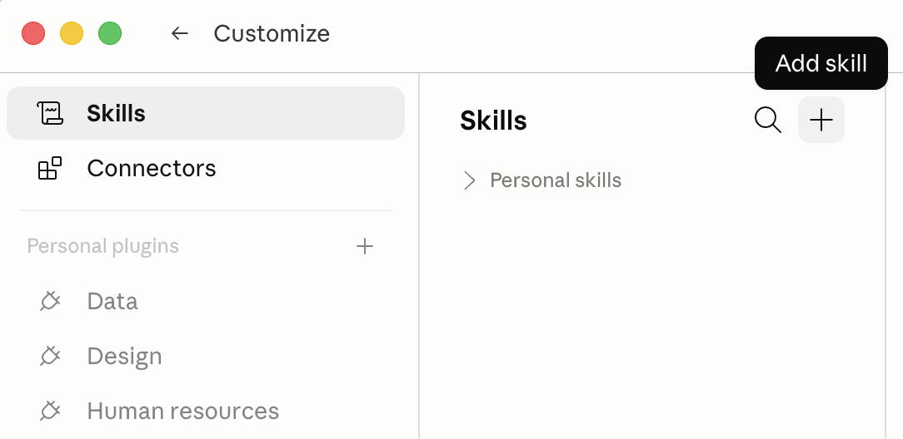
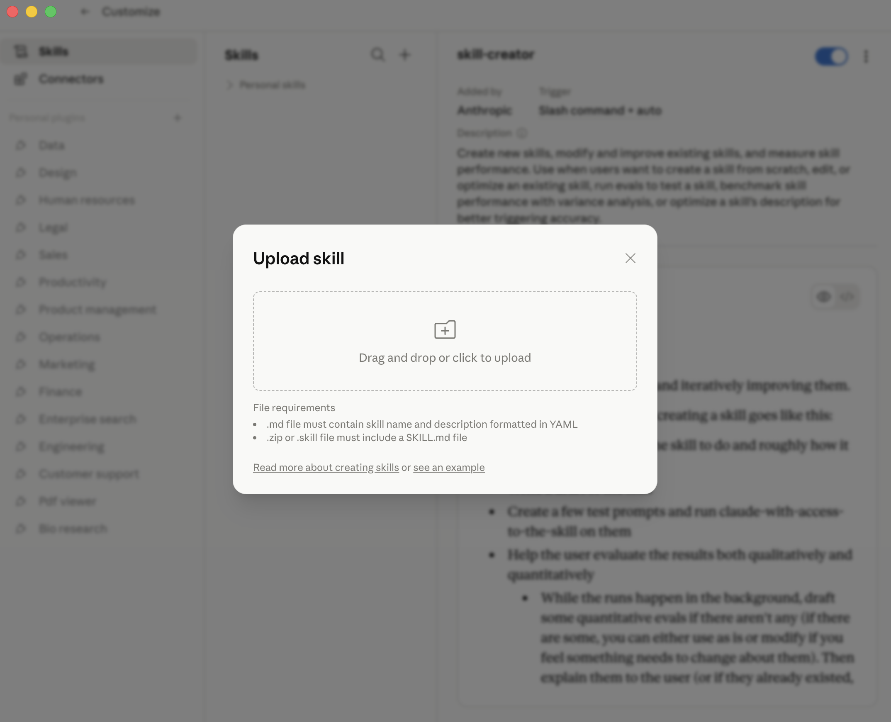

# VUSM Student Skills — Private Preview

Two Claude skills for Vanderbilt medical students, built on the VUSM
curriculum knowledge graph:

- **Student Coach** — a study *planner*. What to study, how deeply, how a
  topic builds across your four years, how to prep for a session or
  rotation, where you stand on board coverage.
- **Student Tutor** — active *practice*. Quizzing at a target depth,
  Socratic clinical cases, illness scripts, problem-representation
  drills, USMLE-style items, spaced review. It withholds answers on
  purpose — it hints and asks you to reason first.

Both talk to a read-only curriculum server I (Shane Stenner) maintain;
your access is scoped to read-only curriculum queries and is revocable
any time.

> **Private preview.** These skills are being shared with a handful of
> people for feedback. Please don't redistribute the bundles you
> received — each install carries an individual API key tied to you.

---

## What you'll need (30 seconds)

- A Claude account — the **desktop app** (Mac or Windows) or **claude.ai**
  in your browser. Either works.
- The **two** personalized `.zip` files Shane sent you:
  `student-coach-<your-name>.zip` and `student-tutor-<your-name>.zip`.

No Terminal, no GitHub account, no command-line tools.

---

## Install (~5 minutes)

**The canonical source** for adding custom skills is Anthropic's support
article — it stays current as Claude evolves:
**[Use Skills in Claude — Add and Use Custom Skills](https://support.claude.com/en/articles/12512180-use-skills-in-claude#h_a4222fa77b)**.
The short version is below; if the UI you see differs, defer to that page.

### Step 1: One-time prerequisites

Open **Settings → Capabilities** and confirm:

1. **"Code execution and file creation"** is on — lets the skills run the
   code that talks to the curriculum API.
2. **"Allow network egress"** is on — lets that code reach the internet.

   

3. **Domain allowlist** includes the curriculum API hostname. Scroll to
   the **"Additional allowed domains"** field and paste:

   ```
   vusm-curriculum-api.shanestenner.workers.dev
   ```

   Click **Add**. (The "Domain allowlist" dropdown above can stay on its
   default — "Package managers only" works as long as our hostname is in
   the additional-domains list. Or switch it to "All domains.")

   

Without step 3, the skills load but every query fails with a "can't
reach the API" error — Claude's sandbox blocks any hostname not in the
allowlist.

### Step 2: Open the Skills section

Navigate to **Customize → Skills**.



### Step 3: Upload **both** skill bundles

Click the **"+"** at the top of the Skills list → **"+ Create skill"** →
**"Upload a skill"**.



Do this **twice** — once for each zip Shane sent you:

- `student-coach-<your-name>.zip` → installs **Student Coach**
- `student-tutor-<your-name>.zip` → installs **Student Tutor**

### Step 4: Verify both are in the list

Both skills should appear with a toggle (default: on). They activate
automatically — Student Coach when you're planning what/how to study,
Student Tutor when you ask to be quizzed or work a case.

Platform-specific walkthroughs if you hit a snag:
- **claude.ai web** — [INSTALL_CLAUDE_AI.md](INSTALL_CLAUDE_AI.md)
- **Desktop app** — [INSTALL_DESKTOP.md](INSTALL_DESKTOP.md)

---

## Try them (a couple of minutes)

Open a new conversation and try one of these.

**Student Coach** (planning / understanding):
- *"What should I focus on this week before my renal block exam?"*
- *"How does inflammation build across my four years at VUSM?"*
- *"Help me make a study plan for the cardiology block."*

**Student Tutor** (practice — it will make you do the work):
- *"Quiz me on acid-base disorders at an application level."*
- *"Walk me through a clinical case on chest pain, Socratically."*
- *"Build an illness script for heart failure with me."*

If Claude answers like a generic textbook with no VUSM-specific sessions
or objectives, the skill probably isn't loaded — re-check Customize →
Skills. If the Tutor just *gives* you answers instead of making you
reason first, tell us in the feedback form — that's a behavior we want
to know about.

---

## What we'd love your feedback on

After a session or two with each skill, please take ~5 minutes for the
REDCap form — see [FEEDBACK.md](FEEDBACK.md). It's anonymous unless you
add your name. We're especially interested in:

- **Student Coach** — was the study planning genuinely useful?
- **Student Tutor** — did the hint-before-answer, reason-first pacing
  help your learning, or just frustrate you? Was the difficulty right?
- Anything **slow, broken, wrong, or surprising** — especially anything
  the skill said that was *factually* off about clinical content or the
  VUSM curriculum.

---

## A note on security and your data

- Each zip contains an **individual API key** scoped to you. It allows
  only read access to the curriculum knowledge graph — it cannot upload,
  modify, or read anyone's records.
- The skills keep a **personal learner profile on your own machine**
  (`~/.vusm-companion/profile.md`) — what you've practiced, your
  self-assessments. It is local-only; it never leaves your device and
  faculty cannot see it.
- The curriculum API has **no student-level data and no PHI** — only
  course objectives, session metadata, and concept mappings.
- Lost laptop, or want access revoked? **Email me — I revoke within the
  minute**, and both bundles stop working immediately.
- Please don't share the zips. If someone else wants to try the skills,
  ask me to issue them their own.

---

## FAQ

**Does this access my records, grades, or PHI?**
No. The curriculum knowledge graph is course/session/concept metadata
only. Your learner profile is local to your machine and faculty-inaccessible.

**What does it cost?**
Nothing — it's a research/internal tool.

**Will the answers always be right?**
Claude can hallucinate. Treat answers as a smart study-partner's
first-pass take — verify before relying on them, and flag anything wrong
in the feedback form.

**Can I uninstall?**
Any time — Customize → Skills → Remove. Let me know and I'll revoke the key.

---

## Questions?

Email Shane Stenner — same address that sent you the bundles.
